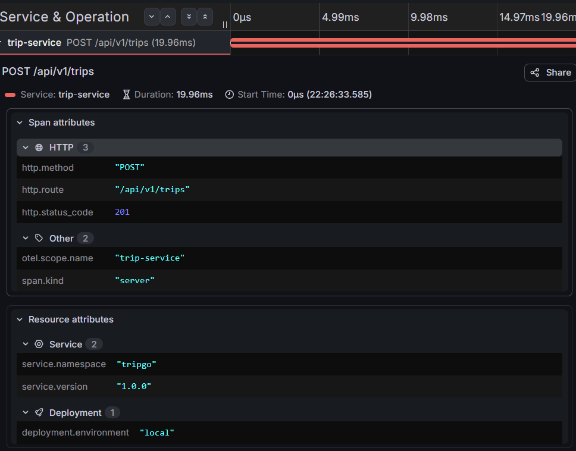
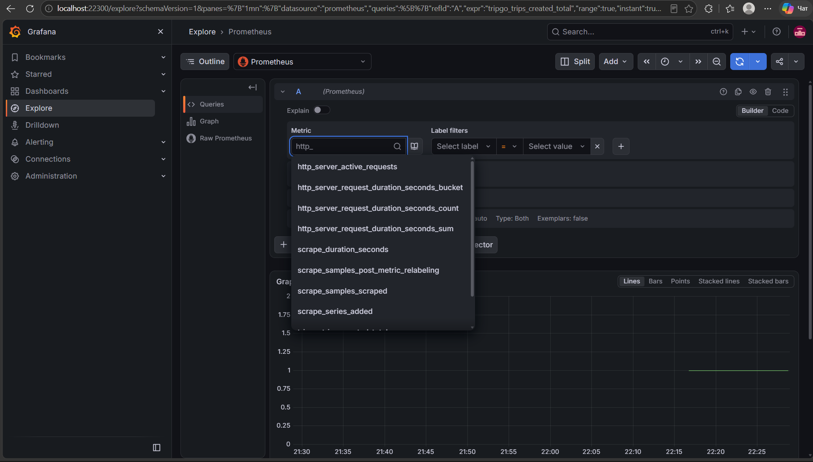

## Архитектура

Сервис построен по принципам **Clean Architecture** (слоистая архитектура) с однонаправленными зависимостями, направленными внутрь к бизнес-логике.

### Структура слоёв и зависимости

1. **`internal/domain/`** — Чистая бизнес-логика и правила (статусы поездок, переходы состояний, доменные ошибки). Не знает ничего про базы данных, веб-фреймворки и HTTP.
2. **`internal/usecase/`** — Сценарии использования (бизнес-процессы приложения). Содержит бизнес-логику координации, объявленные узкие интерфейсы (`contract.go`) и покрыт юнит-тестами с `gomock`.
3. **`internal/http/`** — Транспортный уровень (HTTP-хендлеры на базе `go-chi`). Отвечает за парсинг запросов, вызов usecase и маппинг ошибок через `internal/http/domainerror`.
4. **`internal/repository/`** — Инфраструктурный слой доступа к данным (`pgxpool`, PostgreSQL). Реализует интерфейсы, запрошенные в usecase.
5. **`internal/infra/`** — Инициализация инфраструктуры (подключение к Postgres, менеджер транзакций, настройка OpenTelemetry и структурного логгера `slog`).

### Где объявлены интерфейсы и почему там?
Все интерфейсы зависимостей (например, `tripRepository`, `txManager`) объявлены **на стороне потребителя** — в файлах `contract.go` внутри пакетов `usecase/...`. 

**Почему именно там?**
* **Принцип инверсии зависимостей (DIP):** Модуль бизнес-логики сам определяет, какой контракт ему нужен для работы, а не подстраивается под готовую реализацию репозитория.
* **Изоляция и тестируемость:** Благодаря этому слои `usecase` можно тестировать изолированно, легко подменяя реальный репозиторий сгенерированными через `mockgen` моками без необходимости поднимать БД

### Список принятых решений

1. **Интерфейсы на стороне потребителя:** Все зависимости (репозитории, менеджеры транзакций) объявлены в виде узких интерфейсов прямо в пакетах usecase (`contract.go`), что упрощает юнит-тестирование с `gomock`.
2. **Единый маппинг ошибок:** Ошибки домена (`ErrTripNotFound`, `ErrTripCompleted`, `ErrDriverBusy`) маппятся на OpenAPI-структуру `api.Problem` в единственной точке (`internal/http/domainerror`).
3. **Безопасность системных ошибок:** Непредвиденные сбои возвращают `500 Internal Server Error` без утечки деталей реализации и стектрейсов в тело ответа.
4. **Инструментирование БД через `otelpgx`:** Запросы к PostgreSQL оборачиваются автоматически на уровне пула соединений, обеспечивая единые спаны без зашумления кода репозиториев.
5. **Корреляция логов:** Использование `log/slog` с пробросом `trace_id` и `span_id` в каждый контекст через OTel middleware.

