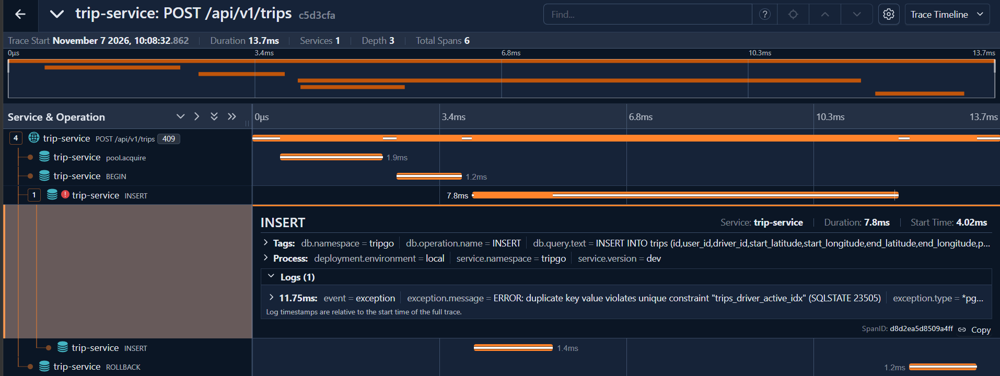
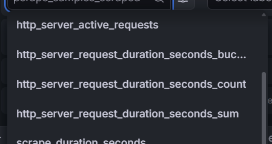

## Архитектура

Сервис построен по принципам **Clean Architecture** (слоистая архитектура) с однонаправленными зависимостями, направленными внутрь к бизнес-логике.

### Структура слоёв и зависимости

1. **`internal/domain/`** — Чистая бизнес-логика и правила (статусы поездок, переходы состояний, доменные ошибки). Не знает ничего про базы данных, веб-фреймворки и HTTP.
2. **`internal/usecase/`** — Сценарии использования (бизнес-процессы приложения). Содержит бизнес-логику координации, объявленные узкие интерфейсы (`contract.go`) и покрыт юнит-тестами с `gomock`.
3. **`internal/http/`** — Транспортный уровень (HTTP-хендлеры на базе `go-chi`). Create-хендлер декодирует сгенерированный тип `api.TripData` и проверяет обязательные поля и ограничения контракта. Транспортный слой преобразует доменные модели в сгенерированные API-типы и маппит ошибки через `internal/http/domainerror`.
4. **`internal/repository/`** — Доступ к данным PostgreSQL через интерфейсы репозитория, объявленные на стороне usecase.
5. **`internal/infra/`** — Инициализация инфраструктуры (подключение к Postgres, менеджер транзакций, настройка OpenTelemetry и структурного логгера `slog`).
6. **`cmd/trip-service/`** — Точка входа и composition root: читает конфигурацию, создаёт telemetry SDK и пул PostgreSQL, затем связывает репозиторий, usecase, HTTP-хендлеры и роутер. `internal/container/` содержит вспомогательный конструктор зависимостей, но текущий `main` его не вызывает.
7. **`internal/model/`** — Внутренние DTO и структуры для передачи данных между слоями; типы API и репозитория не протекают в usecase.

Зависимости направлены внутрь: HTTP-хендлеры зависят от интерфейсов usecase, репозиторий реализует интерфейсы, объявленные usecase, а usecase зависит от домена и внутренних моделей. Доменный слой не зависит от HTTP, PostgreSQL или инфраструктуры. В рабочем пути запуска пул и реализации создаются в `cmd/trip-service/main.go`.

### Где объявлены интерфейсы и почему там?
Интерфейсы объявлены на стороне потребителя. Репозитории и менеджер транзакций (`tripRepository`, `txManager`) описаны в `contract.go` соответствующих пакетов `internal/usecase/trip/...`. Интерфейс usecase для HTTP-хендлера (`Usecase`) находится в `contract.go` пакета `internal/http/trip/{create,get,finish}`.

**Почему именно там?**
* **Принцип инверсии зависимостей (DIP):** Модуль бизнес-логики сам определяет, какой контракт ему нужен для работы, а не подстраивается под готовую реализацию репозитория.
* **Изоляция и тестируемость:** Благодаря этому usecase и HTTP-хендлеры можно тестировать изолированно, подменяя зависимости сгенерированными через `mockgen` моками.

### Список принятых решений

1. **Интерфейсы на стороне потребителя:** Все зависимости (репозитории, менеджеры транзакций) объявлены в виде узких интерфейсов прямо в пакетах usecase (`contract.go`), что упрощает юнит-тестирование с `gomock`.
2. **Единый маппинг ошибок:** Ошибки домена (`ErrTripNotFound`, `ErrTripCompleted`, `ErrDriverBusy`) маппятся на OpenAPI-структуру `api.Problem` в единственной точке (`internal/http/domainerror`).
3. **Безопасность системных ошибок:** Непредвиденные сбои возвращают `500 Internal Server Error` без утечки деталей реализации и стектрейсов в тело ответа.
4. **Инструментирование БД:** `otelpgx` создаёт SQL-спаны; query tracer записывает `db.client.operation.duration` с атрибутами `db.operation.name`, `db.collection.name`, `error.type`. Репозитории не создают собственные DB-спаны.
5. **Корреляция HTTP-логов:** Итоговая JSON-запись HTTP middleware включает `trace_id` и `span_id`, если для запроса создан валидный span. Эти атрибуты не добавляются автоматически во все логи приложения.
6. **Атомарная история статусов:** Создание поездки и переход `active → completed` записываются вместе с `trip_status_history` в одной транзакции. Завершение блокирует строку поездки и использует доменную операцию `Trip.Finish`.

### Логи, метрики и трейсы

После middleware идентификатора запроса цепочка проходит через **Tracing → Logging → Metrics → Recover**. Recover расположен внутри остальных middleware, чтобы паника преобразовалась в ответ `500` до того, как отложенные логирование, метрики и завершение span запишут итоговый статус. На запрос создаётся итоговая JSON-запись `http request` с шаблоном маршрута, статусом, длительностью и trace-корреляцией; при панике дополнительно записываются сообщение и stack trace. Тела запроса и ответа в логи не добавляются.

HTTP-метрики включают длительность ответа и число активных запросов с меткой `http.route`, содержащей шаблон маршрута. DB histogram `db.client.operation.duration` записывается в секундах с атрибутами из каталога телеметрии. Счётчики созданных и завершённых поездок увеличиваются только после успешного commit. Gauge `tripgo.trips.active` запрашивает число поездок в статусе `active` в PostgreSQL при каждом сборе метрик. Метрики и трейсы экспортируются по OTLP.

### Настройки запуска и проверки

Сервис читает `HTTP_ADDR`, `LOG_LEVEL`, `SHUTDOWN_TIMEOUT`, `DATABASE_URL`, параметры пула, `DATABASE_CONNECT_TIMEOUT`, `DATABASE_QUERY_TIMEOUT` и `OTEL_EXPORTER_OTLP_ENDPOINT`. Примеры значений находятся в `.env.example`.

```sh
make lint
make test
make test-integration
```

`make test` запускает тесты с `-race` и печатает суммарное покрытие домена и usecase, завершаясь ошибкой при результате ниже 50%. `make test-integration` запускает интеграционные тесты с build-тегом `integration`; для них требуется PostgreSQL из окружения и `DATABASE_URL`.

`make lint` явно использует `.golangci.yml`.




